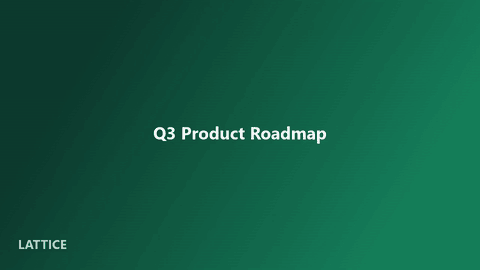
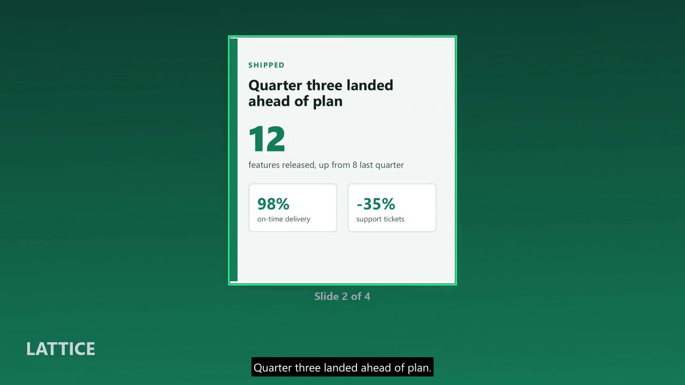
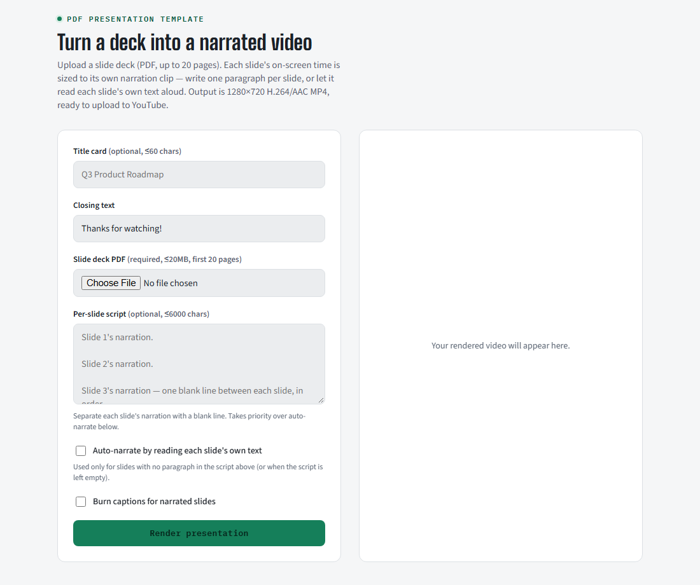
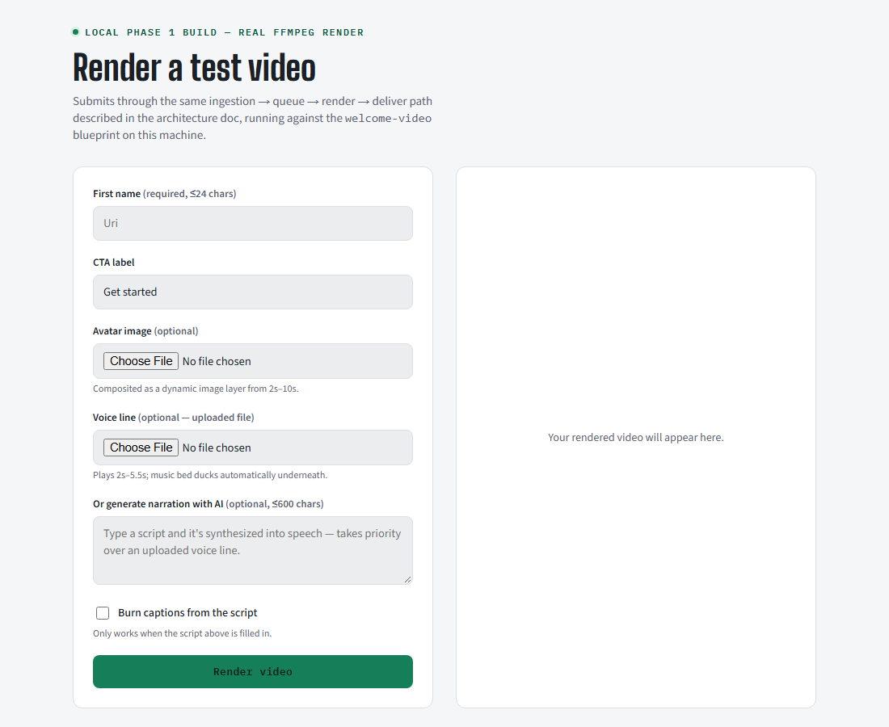

# Lattice

A personalized-video render engine. It fills layered video blueprints with per-recipient data (names, images, narration, PDFs) and renders MP4s with FFmpeg. This is a single-process local build: REST API + job queue + compositor, no cloud required.

Three templates ship with it:

| Template | Endpoint | What it makes |
|---|---|---|
| `welcome-video` | `POST /api/render` | 10s personalized greeting: name overlay, optional avatar image, optional narration |
| `contract-walkthrough` | `POST /api/render/contract` | Name intro + page-by-page flythrough of an uploaded PDF (first 6 pages) |
| `pdf-presentation` | `POST /api/render/presentation` | Slide deck PDF (first 20 pages) to a narrated MP4 sized for YouTube: 1280x720, H.264/AAC |

Narration can be an uploaded audio clip or typed text synthesized to speech ("AI narration"), with optional burned-in captions.

## Demo

A 4-slide deck ([`examples/sample-deck.pdf`](examples/sample-deck.pdf)) turned into a narrated 41-second video by the `pdf-presentation` template, with a title card, per-slide narration (offline text-to-speech), synced captions and a closing card:



*Preview of the first 20 seconds. [Download the full video with narration (MP4, 3 MB)](docs/demo.mp4).*



**Reproduce it:** start the app, open the "Turn a deck into a narrated video" form, and set:

- Title card: `Q3 Product Roadmap`
- Slide deck PDF: `examples/sample-deck.pdf`
- Per-slide script (blank line between slides):

  ```
  Welcome to the quarterly roadmap update. Here is what shipped, what we learned, and what comes next.

  Quarter three landed ahead of plan. We released twelve features, up from eight last quarter, with ninety eight percent on time delivery.

  Customers told us they want it faster. Setup time is the top complaint, and templates beat blank canvases.

  Next up is the mobile release. Beta starts in October, with a public launch in December.
  ```

- Check **Burn captions**, then **Render presentation**. It takes about 20 seconds.

Or from the command line:

```
curl -X POST http://127.0.0.1:4173/api/render/presentation \
  --form-string "title=Q3 Product Roadmap" \
  -F "deck_pdf=@examples/sample-deck.pdf;type=application/pdf" \
  --form-string "auto_narrate=on" \
  --form-string "burn_captions=on"
```

(`auto_narrate` reads each slide's own text aloud, so no script is needed.)

## Screenshots

The web UI has one form per template. Each form posts to the API and shows the rendered video in the panel beside it once the job finishes.

**PDF presentation form**



**Welcome video form**



## Requirements

- **Node.js 18+**
- **FFmpeg** with the `subtitles` filter (libass). Use a release build: some git/master snapshots (including WinGet's `Gyan.FFmpeg`) dropped `-filter_complex_script`. The app still runs on those, but large renders can fail with `spawn ENAMETOOLONG`.
- **Poppler** (`pdftoppm`, `pdftotext`) for PDF handling
- **Windows** for text-to-speech (it uses the built-in SAPI voices via PowerShell). On other platforms everything works except typed-script narration.

Windows install:

```
winget install BtbN.FFmpeg.GPL.6.1
winget install oschwartz10612.Poppler
```

## Run

```
npm install
npm start
```

Open http://127.0.0.1:4173. The first launch pre-renders a cached base plate and music bed (a few seconds); later renders reuse them. Startup prints a warning for any missing dependency.

```
npm test
```

## Configuration

Tools are auto-detected (env var, then WinGet packages, then `PATH`). Override with environment variables:

| Variable | Purpose | Default |
|---|---|---|
| `PORT` | HTTP port | `4173` |
| `HOST` | Bind address. **The API has no authentication**, so it listens on loopback only. Set `0.0.0.0` only on a trusted network. | `127.0.0.1` |
| `FFMPEG_PATH` | ffmpeg executable | auto-detect |
| `PDFTOPPM_PATH`, `PDFTOTEXT_PATH` | Poppler executables | auto-detect |
| `FONT_BOLD` | Bold `.ttf` used for on-video text | Segoe UI Bold / Arial Bold / DejaVu Bold |

## API

Renders are asynchronous. Submit with `multipart/form-data`, get `202` with a `job_id`, then poll `GET /api/jobs/:id` until `status` is `complete` (`output_url` is then set) or `failed` (`error` explains why).

```
curl -X POST http://127.0.0.1:4173/api/render \
  --form-string first_name=Ada \
  --form-string "narration_script=Hi Ada, welcome aboard." \
  --form-string burn_captions=on
```

Blueprints live in `templates/*.json`. Jobs run one at a time through an in-memory queue; finished jobs are forgotten after an hour (the MP4s stay in `output/`).

## How it works

- `lib/compositor.js` builds an FFmpeg `filter_complex` graph from a blueprint: text with fade keyframes, dynamic image layers, ducked music under narration, timed end cards. Static layers (background, music) are rendered once and cached in `data/`.
- `lib/pdf.js` rasterizes PDF pages (`pdftoppm`) and extracts slide text (`pdftotext`) for auto-narration.
- `lib/tts.js` / `lib/tts.ps1` synthesize speech offline with Windows SAPI.
- `lib/captions.js` paces caption chunks across the synthesized audio's real duration and writes an `.ass` subtitle file, burned in with a single `subtitles` filter pass.
- `lib/config.js` locates external tools and checks them at startup.
- In the presentation template each slide's on-screen time is sized to its own narration clip, and the per-slide audio clips are joined with the `concat` filter so video and audio share the same timeline.

## Known limitations

- Single worker, CPU encode (`libx264`), in-memory job store (a restart forgets job history).
- Caption timing is proportional to word count, not true word alignment.
- On-video text is restricted to a safe ASCII subset rather than fully escaped for FFmpeg filter syntax.
- Only the voices installed in Windows are available; there is no voice picker yet.
- A render running longer than 5 minutes is killed (`RENDER_TIMEOUT_MS` in `lib/compositor.js`) so one runaway job can't block the queue.

### FFmpeg ordering quirk (don't "tidy" this)

In the FFmpeg build this was developed against, applying the `subtitles` filter *downstream of a `scale` filter* (even indirectly, through `overlay`) silently renders nothing. Inserting a `format=` filter to work around it made renders hang. The fix is the filter order: captions are always composited **before** any page/avatar `scale` + `overlay` step, and `DOC_H` in `lib/compositor.js` is kept short to leave room below the slide panel for captions. Re-test captions before changing that order.
